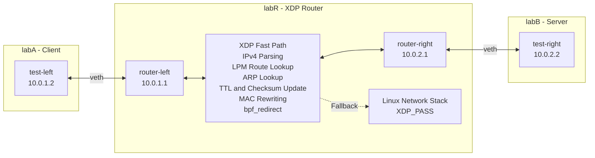

# eBPF/XDP In-Kernel Packet Forwarder

An IPv4 packet forwarder implemented in C using **eBPF and XDP (eXpress Data Path)**, designed to process and redirect network packets through a kernel-space forwarding path.

The project explores Linux networking, eBPF maps, verifier-safe packet parsing, routing-table lookups, packet-header manipulation, and the design of fast-path and slow-path packet processing.

The implementation runs in **generic XDP (SKB) mode** using Linux network namespaces and virtual Ethernet interfaces.

## Features

- **IPv4 forwarding:** Bidirectional packet forwarding using `bpf_redirect()`.
- **Longest-prefix matching:** IPv4 route lookups using `BPF_MAP_TYPE_LPM_TRIE`.
- **ARP cache:** BPF hash map populated from the lab topology during initialization, with a userspace ARP helper for processing ARP replies.
- **Packet-header modification:** Ethernet source/destination MAC rewriting, TTL decrement, and incremental IPv4 checksum updates.
- **eBPF maps:** Shared routing, ARP, interface MAC, and forwarding statistics maps.
- **Fast-path/slow-path separation:** Eligible IPv4 packets are forwarded directly through XDP, while exceptional traffic follows explicit fallback or drop handling.
- **Automated integration tests:** Validation of forwarding behavior and failure scenarios using Linux network namespaces.
- **Performance benchmarking:** UDP throughput measurements comparing generic XDP forwarding with standard Linux IP forwarding.

## Architecture

The router is tested using three Linux network namespaces connected through two virtual Ethernet (veth) pairs.



The XDP program is attached to both router interfaces, enabling bidirectional IPv4 forwarding.

**Fast path:** Eligible packets undergo route lookup, ARP lookup, TTL and checksum updates, Ethernet MAC rewriting, and redirection through `bpf_redirect()`.

**Slow path:** Traffic that cannot be handled by the fast path, including non-IPv4 packets, fragmented packets, and forwarding exceptions, is passed to the normal Linux network stack using `XDP_PASS`.


## Development Environment

- Ubuntu 24.04 on WSL2
- Linux network namespaces and veth interfaces
- Clang/LLVM for eBPF compilation
- libbpf and bpftool
- C for the XDP program and userspace helpers
- Bash and Python for testing and benchmark analysis
- iperf3 and tcpdump for traffic generation and inspection

## Quick Start

The project has been developed and tested on Ubuntu 24.04 under WSL2 using generic XDP mode.

### 1. Build

From the project root:

```bash
make all
```

This builds the XDP program, route loader, and ARP helper.

### 2. Start the router

```bash
sudo bash scripts/start_router.sh
```

This script:

- Creates three Linux network namespaces and their veth interfaces.
- Generates routing entries using dynamically detected interface indices.
- Loads the XDP program and initializes its BPF maps.
- Populates routes, local IP addresses, ARP entries, and interface MAC addresses.
- Disables normal Linux IP forwarding in the router namespace.
- Attaches the XDP program to both router interfaces.

### 3. Run integration tests

```bash
sudo bash scripts/test_xdp_forwarding.sh
```

The six automated tests verify normal forwarding, TTL expiration, route misses, ARP cache misses and recovery, ICMP burst forwarding, and TCP forwarding.

### 4. Clean up

```bash
sudo bash scripts/teardown_lab.sh
sudo bash scripts/cleanup_bpf.sh
```

These commands remove the test namespaces and project-specific pinned BPF objects.

### Requirements

The environment requires Clang/LLVM, a C compiler, Make, libbpf development headers, bpftool, iproute2, Python 3, and standard Linux networking utilities.

**Note:** The current scripts reference `/usr/lib/linux-tools-6.8.0-147/bpftool` explicitly. Adjust that path if your installation uses a different location. Root privileges and a kernel supporting eBPF/XDP are required.

## Performance Benchmark

The XDP router was benchmarked against standard Linux IPv4 forwarding using `iperf3` UDP traffic.

### Test environment

- Ubuntu 24.04 on WSL2
- Generic XDP (SKB) mode
- Three network namespaces connected through two veth pairs
- UDP traffic with 1,400-byte payloads
- Requested sending rate: 2 Gbps
- Test duration: 15 seconds per run
- Five runs per forwarding configuration

For the Linux baseline, the XDP programs were detached and Linux IP forwarding was enabled. For the XDP configuration, Linux IP forwarding was disabled and the XDP program was attached to both router interfaces.

### Results

| Metric | Linux forwarding | Generic XDP |
|---|---:|---:|
| Mean throughput | 1.292 Gbps | 1.258 Gbps |
| Median throughput | 1.260 Gbps | 1.270 Gbps |
| Standard deviation | 0.0676 Gbps | 0.0277 Gbps |
| Aggregate UDP packet loss | 0.0227% | 0.0557% |

Linux forwarding achieved approximately 2.7% higher mean throughput than generic XDP in these measurements. However, run-to-run variability was substantial relative to the observed difference.

**The results do not establish a consistent performance advantage for either implementation.**

### Limitations

- The experiments used generic XDP on virtual interfaces, not native XDP on physical network hardware.
- The sample size was limited to five runs per configuration.
- CPU scheduling and virtualization overhead may influence performance.
- UDP receive-buffer limitations contributed to packet losses during testing.
- These results measure end-to-end network throughput, not isolated XDP execution time or per-packet forwarding latency.

The original C++ userspace router comparison is planned as future work.

## Project Status

**Functional IPv4 forwarding implementation completed.**

Automated forwarding tests and initial performance benchmarks have been completed. Further work includes documentation, CI integration, and additional comparisons with the original C++ userspace router simulator.
